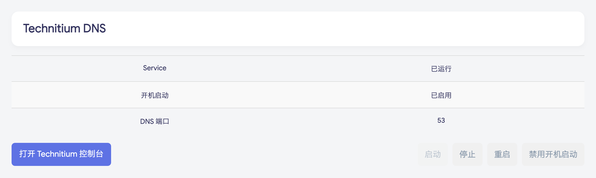
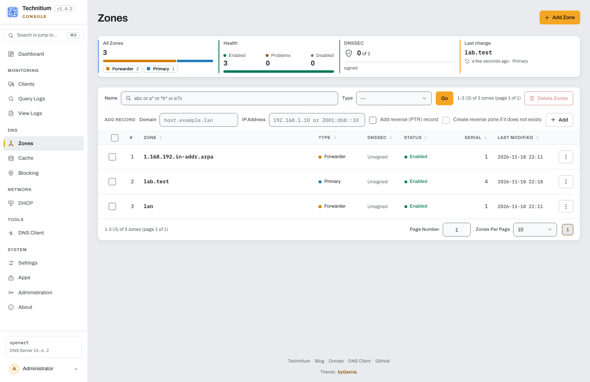

# Technitium DNS for OpenWrt

[简体中文](README.md) | **English**

Native Technitium DNS Server, Technitium Console and a LuCI service manager for OpenWrt. This repository builds and publishes the complete installation.

| Package | Contents |
| --- | --- |
| `technitium` | [Technitium DNS Server](https://github.com/TechnitiumSoftware/DnsServer) 15.6.2, [Technitium Console](https://github.com/byGarcia/technitium-console) 1.4.2, ASP.NET Core 10.0.15 musl runtime, procd service and backup paths |
| `luci-app-technitium` | LuCI status, start/stop/restart, boot settings and console entry |
| `luci-i18n-technitium-zh-cn` | Simplified Chinese translation for the LuCI app |

The current native package supports **OpenWrt 25.12 on x86/64**. The LuCI package is architecture independent. Other CPU architectures require a matching native runtime package.

## Installation and service defaults

Download the server and LuCI APKs together from [Releases](https://github.com/jearton/luci-app-technitium/releases), plus the translation APK if needed. Verify the files against the accompanying `SHA256SUMS`. Upload them to the router, using its actual LAN address.

```sh
scp -O technitium-15.6.2-r2.apk luci-app-technitium-1.1.0-r1.apk root@192.168.1.1:/tmp/
ssh root@192.168.1.1
```

On the router, install both APKs. APK resolves the runtime library dependencies using the router's configured repositories.

```sh
apk add --allow-untrusted /tmp/technitium-15.6.2-r2.apk /tmp/luci-app-technitium-1.1.0-r1.apk
```

When the required system libraries are already installed, use this offline command.

```sh
apk --no-network --repositories-file /dev/null --allow-untrusted add /tmp/technitium-15.6.2-r2.apk /tmp/luci-app-technitium-1.1.0-r1.apk
apk --no-network --repositories-file /dev/null list -I technitium luci-app-technitium
```

The required system packages are `libstdcpp6`, `libgcc1`, `libopenssl3`, `libatomic1`, `zlib`, `ca-bundle`, `rpcd-mod-ucode` and `ucode-mod-fs`. LuCI must already be installed. Standalone APKs use `--allow-untrusted` for that invocation. [OpenWrt APK documentation](https://openwrt.org/docs/guide-user/additional-software/apk)

A **fresh installation leaves Technitium stopped and disabled on boot**. Open **Services → Technitium DNS** to start it and choose whether to enable it on boot. Before first startup, configure the existing DNS resolver so port 53 is available. The initial startup checks for an existing DNS listener.

Package upgrades retain the existing service's boot and running states and preserve `/etc/technitium/`. Firmware builders can explicitly enable the service after installing the packages and configuring their DNS integration.

The generic packages leave DHCP, firewall, OpenClash, other DNS services and local forwarding zones under the router administrator's control. Optional Advanced Forwarding 5.2 is bundled as an archive for installation from the Technitium console.

## First console login

Open **Services → Technitium DNS**, confirm the service is running and select **Open Technitium Console**. The current console entry uses HTTP port `5380` at the same hostname as LuCI. The initial DNS port is `53`. Change the DNS listener port in Technitium Console. LuCI reads the service process's actual TCP/UDP listeners and shows “Not listening” while stopped. Changing the console HTTP port requires updating the current LuCI console entry.

The username is `admin`. Read the randomly generated initial password on the router through the LuCI terminal or your SSH management connection.

```sh
cat /etc/technitium/setup-password
```

Sign in and change the password in the console. This file retains the initial password after a password change. After confirming the new password works, remove the initial password file from the router.

The console uses its own authentication. LuCI RPC permissions control service operations.

## Updating an existing installation

Upload the matching server and LuCI APKs, then use the installation command above. For the v1.1.0 release the LuCI app requires `technitium >= 15.6.2-r2`.

Check that each file exists at the exact destination before installing. The router clears `/tmp` on reboot.

```sh
ls -l /tmp/technitium-15.6.2-r2.apk /tmp/luci-app-technitium-1.1.0-r1.apk
```

Refresh the LuCI page after updating. An update to the backend restarts a previously running service and briefly interrupts its DNS clients. Back up `/etc/technitium/` before upgrading.

## Build and publish

This repository is an OpenWrt feed with two package directories, `technitium/` and `luci-app-technitium/`. Add it to `feeds.conf.default`, install the feed and select the LuCI app. Its package dependencies select the server.

```text
src-git technitium https://github.com/jearton/luci-app-technitium.git
```

```sh
./scripts/feeds update technitium
./scripts/feeds install -a -p technitium
make menuconfig
make package/technitium/compile package/luci-app-technitium/compile V=s
```

Pin a tested tag or commit for firmware releases. DNS Server, Console and runtime archives have fixed versions and SHA-256 checks in `technitium/Makefile`.

[Actions](https://github.com/jearton/luci-app-technitium/actions) builds all three APKs using the OpenWrt 25.12.6 SDK on Linux. An isolated IPv4-only x86 VM tests upgrading the previous bundled service, all four running/boot-state combinations, fresh offline installation, port conflicts, DNS records and console login. The regression test starts from a checksum-pinned prior firmware image. Package builds use this repository and the upstream OpenWrt SDK.

Version tags publish the three APKs, a local `packages.adb` index and checksums to [Releases](https://github.com/jearton/luci-app-technitium/releases) and [GHCR](https://github.com/jearton/luci-app-technitium/pkgs/container/luci-app-technitium), followed by download verification.

## Screenshots

**Services → Technitium DNS**

LuCI v1.0.2 rendered in Chrome with the Argon theme and example service status.



**Technitium Console → Zones**

Captured from Technitium Console 1.4.2 in the x86/64 OpenWrt lab.


