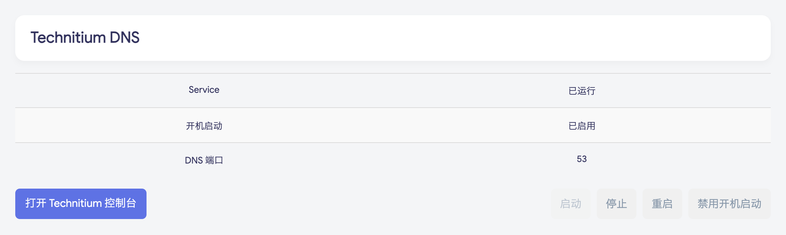
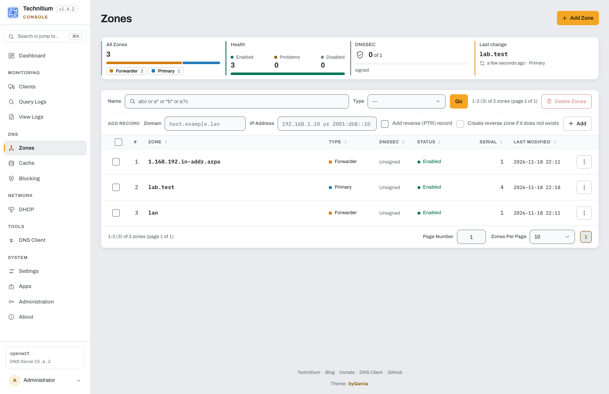

# LuCI app for Technitium DNS

Open **Services → Technitium DNS** to check the native service, manage startup and open the Technitium web console. Account, zone and DNS settings are managed in the Technitium console.

The plugin uses OpenWrt's LuCI, rpcd and procd interfaces. Build it using the standard LuCI feed alongside a compatible native `technitium` package.

LuCI's RPC ACL separates status and service control. The Technitium console has its own login. LuCI does not store its credentials.

## Requirements and compatibility

- OpenWrt 25.12 with LuCI and `rpcd-mod-ucode`. Published packages use the OpenWrt APK format.
- A native package named `technitium`, version `15.6.2-r1` or later, providing `/etc/init.d/technitium` and registering the service with procd as `technitium`.
- The service script supports `start`, `stop`, `restart`, `enable`, `disable` and `enabled`.
- The current plugin reports DNS port `53` and opens the console on HTTP port `5380` at the same hostname as LuCI. Deployments using different ports require an integration change.

The LuCI package is architecture independent. The DNS server and .NET runtime need builds for the router's architecture. The verified installation uses x86/64, OpenWrt 25.12 and Argon.

One compatible native package is maintained in the [openwrt-pro package sources](https://github.com/jearton/openwrt-pro/tree/main/sources/full/package/custom/technitium). Its service integration and initial-password behavior are described below. Other firmware builds can provide the same interfaces.

## First console login

Open **Services → Technitium DNS**, confirm the service is running and select **Open Technitium Console**. Use the account provisioned by your DNS server installation.

With the compatible native package linked above, the username is `admin` and the server generates a random initial password on first startup. Read it through the LuCI terminal or your SSH management connection on the router.

```sh
cat /etc/technitium/setup-password
```

Sign in with that password and change it in the console. This file contains the initial password and does not track later password changes. After confirming you can sign in with your new password, remove the initial password file from the router.

## 首次登录控制台

进入 **服务 → Technitium DNS**，确认服务已运行，点击 **打开 Technitium 控制台**，使用 DNS 服务安装时配置的账号登录。当前插件使用 HTTP 端口 `5380`。

使用上文链接的原生服务包时，用户名为 `admin`，初始密码由服务首次启动时随机生成。在 OpenWrt 的 LuCI 终端或 SSH 管理连接中执行以下命令查看。其他服务包的初始账号和密码以对应安装说明为准。

```sh
cat /etc/technitium/setup-password
```

登录后在控制台修改密码。该文件保存初始密码，修改密码后仍会显示原值。确认新密码可以登录后，删除初始密码文件。

## Update an existing installation

On a router that already has the native `technitium` package, update the LuCI plugin with the `luci-app-technitium-*.apk` file from [Releases](https://github.com/jearton/luci-app-technitium/releases). Verify the download against the accompanying `SHA256SUMS`. The existing Chinese translation package can be kept for the v1.0.2 layout fix.

Copy the verified APK from your computer. This example uses the default LAN address and the v1.0.2 filename.

```sh
scp -O luci-app-technitium-1.0.2-r1.apk root@192.168.1.1:/tmp/
ssh root@192.168.1.1
```

On the router, check that the uploaded file exists at the exact path. If it is missing, repeat the copy from your computer and check the destination address. The router clears `/tmp` on reboot.

```sh
ls -l /tmp/luci-app-technitium-1.0.2-r1.apk
```

If the router already has the native `technitium` and `rpcd-mod-ucode` packages, this update works offline. The install command skips repository configuration for this invocation and permits the verified standalone APK. [APK options](https://github.com/alpinelinux/apk-tools/blob/v3.0.5/doc/apk.8.scd)

```sh
apk --no-network --repositories-file /dev/null --allow-untrusted add /tmp/luci-app-technitium-1.0.2-r1.apk
apk --no-network --repositories-file /dev/null list -I luci-app-technitium
```

Refresh **Services → Technitium DNS** in LuCI. The router can stay running during the update.

## Screenshots

**Services → Technitium DNS**

LuCI v1.0.2 rendered in Chrome with the Argon theme and example service status.



**Technitium Console → Zones**

Captured from Technitium Console 1.4.2 in the x86/64 OpenWrt lab.



## Builds

[Actions](https://github.com/jearton/luci-app-technitium/actions) builds the OpenWrt 25.12 APK and Simplified Chinese translation. A version tag publishes both APKs and their SHA-256 checksums to [Releases](https://github.com/jearton/luci-app-technitium/releases) and [GHCR](https://github.com/jearton/luci-app-technitium/pkgs/container/luci-app-technitium). Install the matching native `technitium` package as well.
